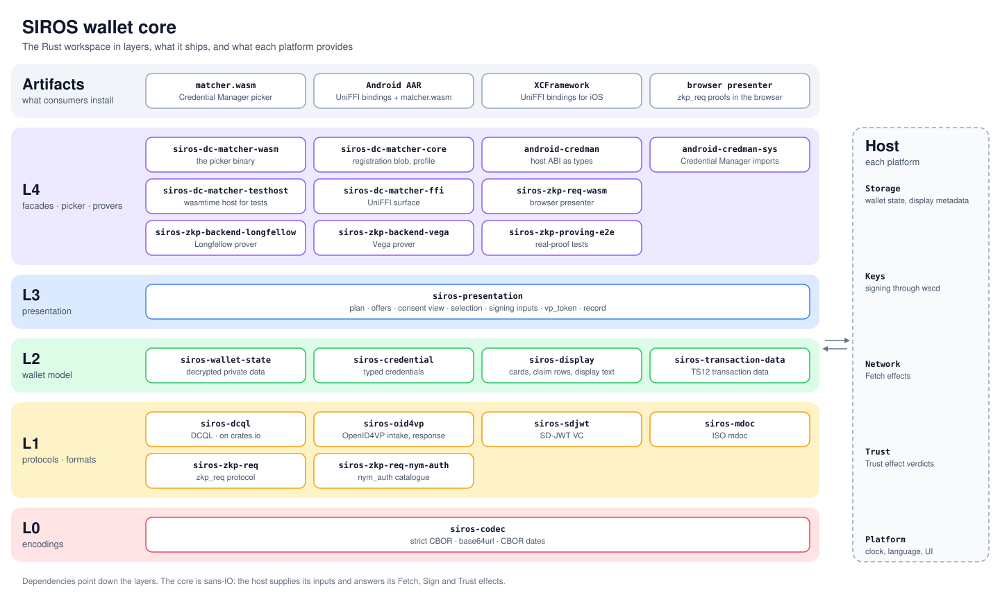

# siros-dc-matcher

The SIROS wallet core, a Rust workspace: the components a wallet presents
credentials with over OpenID4VP 1.0 and the W3C Digital Credentials API, from
request intake to the response — DCQL, SD-JWT VC and ISO mdoc, issuer trust,
display, transaction data on the PaSO model, `zkp_req` proofs and the
presentation component — together with the credential picker Android's
Credential Manager runs (`matcher.wasm`), Kotlin and Swift bindings, and the
`zkp_req` provers with their browser presenter.

On Android, a wallet does not answer a `navigator.credentials.get({digital: …})`
call directly. It registers a snapshot of its credentials with Play Services
ahead of time, and Play Services runs a **matcher** — a WebAssembly module —
inside the credential-picker process to decide which credentials to offer. The
wallet app is launched only after the user picks one.

`matcher.wasm` is that module: the credential picker of the wallet core. It
runs the presentation component's matching, the matching of the wallet's own
plan, over the **registration** the wallet writes with `siros-registration`.
Its rules are code, versioned with the binary.

Released artifacts are on the
[releases page](https://github.com/sirosfoundation/siros-dc-matcher/releases):
`matcher.wasm` and its digest, an Android AAR, and an XCFramework.
`siros-dcql` is on [crates.io](https://crates.io/crates/siros-dcql).

## Overview



`scripts/gen_ecosystem_svg.py` writes the diagram; change it there when a crate is added, renamed or removed.

## Build and test

Rust, pinned exactly in `rust-toolchain.toml` (rustup installs it on first use), plus the wasm
target, and binaryen's `wasm-opt` version_116 (the `wasm-opt` crate 0.116.1), the one optimizer
`make matcher` runs:

```sh
rustup target add wasm32-wasip1
make wasm-opt
```

Then:

```sh
cargo test --locked --workspace --all-features   # libraries, FFI, and matcher.wasm
make matcher                            # target/wasm32-wasip1/wasm-release/matcher.wasm
```

`cargo test` covers the matcher binary too, not just the libraries.
`siros-picker-testhost` is a wasmtime host implementing the Credential
Manager ABI, so `crates/siros-picker-testhost/tests/matcher_wasm/` drives the same `.wasm` a device
would run. It runs `make matcher` on demand — but without the wasm target or the pinned
`wasm-opt` those tests **fail**, deliberately, rather than skipping and reporting a green run
that checked nothing.

Before pushing, what CI will check:

```sh
cargo fmt --all -- --check
cargo clippy --locked --workspace --all-targets --all-features -- -D warnings
cargo clippy --locked -p siros-picker --target wasm32-wasip1 \
  --profile wasm-release -- -D warnings
cargo clippy --locked -p android-credman-sys -p android-credman \
  --target wasm32-wasip1 -- -D warnings
python3 scripts/check_panic_sites.py Cargo.toml proving/Cargo.toml
make matcher && python3 scripts/check_matcher_abi.py \
  target/wasm32-wasip1/wasm-release/matcher.wasm
make check-bindings    # committed bindings match the current API
cargo publish --locked --dry-run -p siros-dcql
cargo semver-checks --package siros-dcql   # cargo install cargo-semver-checks --locked
```

What links into the picker holds Rust 1.82 (`rustup toolchain install 1.82`):

```sh
export RUSTUP_TOOLCHAIN=1.82
cargo check --locked --all-features \
  -p siros-codec -p siros-dcql -p siros-dc-matcher-core -p siros-picker \
  -p android-credman-sys -p android-credman \
  -p siros-zkp-req -p siros-zkp-req-nym-auth -p siros-sdjwt -p siros-mdoc \
  -p siros-wallet-state -p siros-credential -p siros-display -p siros-transaction-data \
  -p siros-trust -p siros-registration
cargo check --locked -p siros-oid4vp
cargo check --locked -p siros-trust
cargo check --locked -p siros-presentation --no-default-features
cargo check --locked -p siros-transaction-data --no-default-features
cargo check --locked --all-features --target wasm32-wasip1 \
  -p siros-picker -p android-credman-sys -p android-credman
```

The `+1.82` checks need `rustup toolchain install 1.82 --target wasm32-wasip1`,
and the semver check `cargo install cargo-semver-checks --locked`.

The proof backends and the browser presenter are in the `proving/` workspace; its CI runs from
there:

```sh
cd proving
cargo fmt --all -- --check
cargo clippy --locked --workspace --all-targets -- -D warnings
cargo test --locked --workspace
scripts/fetch-artifacts.sh && cargo test --locked --release -p siros-zkp-proving-e2e -- --ignored
cargo clippy --locked -p siros-zkp-req-wasm --target wasm32-unknown-unknown \
  -- -D warnings       # after rustup target add wasm32-unknown-unknown
cargo build --locked -p siros-zkp-req-wasm --target wasm32-unknown-unknown --release
```

CI also enforces four things a green build does not imply:

- **No panic outside the tests and the matcher.** Each crate root but the
  matcher's and the test host's denies clippy's panic lints outside the
  tests, a new crate's included.
  `scripts/check_panic_sites.py` fails on a root without them and on an
  `allow` of them outside the tests, and finds the panics no lint covers:
  `assert!`, the std methods that panic on an argument, map indexing and
  division by a value.
- **Host ABI imports.** `scripts/check_matcher_abi.py` checks each import of
  `matcher.wasm`, with its signature, against the Credential Manager ABI
  table and the WASI functions the host provides.
- **A 409,600-byte (400 KiB) size budget** for `matcher.wasm`, which runs in someone else's
  process. The picker runs the wallet's matching and transaction data selection over the
  registration (K2): with images passed through and `wasm-opt -Oz` it measures 366,632 bytes,
  and the measured alternatives that drop parts of K2 were declined. Raising the budget takes a
  line in `.github/workflows/ci.yml` and a reason.
- **Browser imports.** The browser presenter's module imports only wasm-bindgen's modules, the
  only ones a browser page provides.

### Bindings and mobile artifacts

Generated bindings are committed under `bindings/`, so consumers do not need
UniFFI to build. Regenerate after any change to the FFI surface — including doc
comments, which are copied through verbatim:

```sh
make bindings          # Kotlin + Swift
make check-bindings    # what CI runs; fails if the committed copies are stale
```

Packaging needs a toolchain per platform:

```sh
cargo install cargo-ndk                    # Android
rustup target add aarch64-linux-android armv7-linux-androideabi x86_64-linux-android
make aar pom
make publish-local                         # into ~/.m2, for a local Gradle build

rustup target add aarch64-apple-ios aarch64-apple-ios-sim x86_64-apple-ios
make xcframework                           # macOS only
```

`make aar` bundles `matcher.wasm` as an asset alongside the native library.
The picker reads the registration `siros-registration` writes; the FFI's
`SirosBlobBuilder` writes the v1 blob of `siros-dc-matcher-core`.

Two profile details are load-bearing and easy to undo:

- `[profile.release]` sets `strip = "debuginfo"`, not `strip = true`. Full
  stripping removes UniFFI's metadata symbols, and binding generation then
  produces no files and exits 0.
- `[profile.release]` keeps `panic = "unwind"`, because UniFFI catches panics
  at the boundary. Only `wasm-release` aborts.

## Crates

| Crate | Target | Contents |
|---|---|---|
| [`siros-codec`](crates/siros-codec) | any | The encodings every wallet core crate shares: strict CBOR and JSON, unpadded base64url, the padded base64 of `x5c`, CBOR's dates, the ES256 signature value and the `https` URL; and the internals the components share. |
| [`siros-dcql`](crates/siros-dcql) | any | OpenID4VP 1.0 DCQL: one parse that enforces Section 6, `trusted_authorities` (§6.1.1), claims path pointers (§7) over any claim tree, selection (§6.4), and the request vocabulary the wallet core shares. No I/O, no platform. Published to crates.io. |
| [`siros-sdjwt`](crates/siros-sdjwt) | any | SD-JWT VC (RFC 9901): the stored credential and its claim tree, disclosure selection, and the presentation with its KB-JWT. |
| [`siros-mdoc`](crates/siros-mdoc) | any | ISO/IEC 18013-5 mdocs: the stored credential with its MSO, element selection, the `DeviceResponse`, and the device signature's signing input. |
| [`siros-oid4vp`](crates/siros-oid4vp) | any | OpenID4VP 1.0: the request as the picker reads it (`UnverifiedRequest`), the mdoc `Handover`, and, with `crypto`, request intake to a verified request, the `vp_token`, its submission as data the host transmits, response encryption, and the Verifier's reply. |
| [`siros-zkp-req`](crates/siros-zkp-req) | any | The `zkp_req` protocol layer: the query and its options, the usable pair, the presentation and the `vp_token`, the Verifier's structural checks. |
| [`siros-zkp-req-nym-auth`](crates/siros-zkp-req-nym-auth) | any | The nym_auth catalogue and its Longfellow and Vega systems: session binding, credential checks, the request policy, the presenter and verifier around a host's prover. |
| [`siros-trust`](crates/siros-trust) | any | Issuer trust (§4.18): the trust store, issuer chains, and the resolution of `trusted_authorities` into the admission of an issuer. Without `chain`, the admission rule the picker runs over the issuer facts. |
| [`siros-wallet-state`](crates/siros-wallet-state) | any | The decrypted wallet state `S` of the private data container, and the presentation record the host appends. |
| [`siros-credential`](crates/siros-credential) | any | The format-independent credential: typed claims, claims path pointers, validity, the instance of a batch, the claim tree the registration carries, and, with `chain`, the issuer chain. |
| [`siros-display`](crates/siros-display) | any | Display metadata and its locale, credential cards, claim labels and rows, display text, purpose lines, proof statement rows and picker fields. |
| [`siros-transaction-data`](crates/siros-transaction-data) | any | `transaction_data` on the PaSO model, with the four EC TS12 types as built-in rulebooks: type definitions and their sources, payload conformance, images, rendering, selection and the KB-JWT claims. Without `wallet`, the selection for the picker. |
| [`siros-presentation`](crates/siros-presentation) | any | The plan of a request over the wallet's credentials, its consent view, and the response to the user's selection. Without `wallet`, the matching for the picker. |
| [`siros-registration`](crates/siros-registration) | any | The picker's registration: the projection of the wallet's credentials the wallet writes (feature `wallet`) and the picker reads. |
| [`siros-picker`](crates/siros-picker) | `wasm32-wasip1` | The credential picker over the presentation component's matching. Ships `matcher.wasm`. |
| [`android-credman`](crates/android-credman) | any | The host ABI as types: nullability, version gating, set shape, the picked entry. |
| [`android-credman-sys`](crates/android-credman-sys) | `wasm32` | The Credential Manager host imports, one module per host level. [`ABI.md`](crates/android-credman-sys/ABI.md) is the contract and its evidence. |
| [`siros-picker-testhost`](crates/siros-picker-testhost) | native, dev | A wasmtime host implementing the Credential Manager ABI, so the shipping `.wasm` is testable off-device. |
| [`siros-dc-matcher-core`](crates/siros-dc-matcher-core) | any | For the FFI: the v1 credential blob and its CBOR codec, the match profile and its evaluator, the capabilities of a registered circuit. |
| [`siros-dc-matcher-ffi`](crates/siros-dc-matcher-ffi) | UniFFI | Kotlin and Swift surface: build the v1 blob, run the core's match in-process, and the `zkp_req` session, `vp_token` and verifier. |
| [`siros-zkp-req-wasm`](proving/siros-zkp-req-wasm) | `wasm32-unknown-unknown` | The `zkp_req` parts of the browser presenter: both provers and the `vp_token`, built with `wasm-pack`. In `proving/`. |
| [`siros-zkp-backend-longfellow`](proving/siros-zkp-backend-longfellow) | any | The Longfellow nym_auth system on `longfellow-libzk-v1`: zk-cred-longfellow behind the rulebook's artifact pins. In `proving/`. |
| [`siros-zkp-backend-vega`](proving/siros-zkp-backend-vega) | any | The Vega nym_auth system on `vega-v1`: zk-cred-vega behind the rulebook's artifact pins. In `proving/`. |
| [`siros-zkp-proving-e2e`](proving/e2e) | native, dev | Real proofs of both nym_auth systems through the presenter and the Verifier. In `proving/`. |

[`docs/abi.md`](docs/abi.md) covers the host ABI as `matcher.wasm` uses it.
[`docs/zkp_req_core.md`](docs/zkp_req_core.md) covers the `zkp_req` crates, their API and the
prover interface. [`docs/zkp_req_request.md`](docs/zkp_req_request.md) and
[`docs/zkp_req_response.md`](docs/zkp_req_response.md) cover the `zkp_req` request and
presentation.

## The registration

The wallet registers the projection of its credentials together with
`matcher.wasm`, and registers again whenever an input of `write` changes: its
credentials, its presentation records (the registration fixes the instance of
each batch the wallet presents next, C5), the display metadata of its cards
and labels, the host's wording and icons, the credentials it presents in the
background, the trust store, the language, the held transaction metadata and
the transaction data configuration, the systems it proves, the form of the
nym_auth `verifier_id`, and the diagnostics flag. Per credential it holds the
typed claims, the card and claim labels in the wallet's language, the issuer
facts the trust store gave at registration, and the transaction data
definitions the credential is served by. A card's title and issuer line come
from the display metadata, else from the texts the host passes in the wallet's
language, which may also give a named issuer's line as a template. Its icon is
a PNG or JPEG of 64 to 256 pixels that the host rasterised and resized, else
the wallet's default icon: Credential Manager drops an entry without an icon,
and shows no SVG. The picker has no clock: its facts hold at registration
time. These are the issuers' admission and the validity of the certificates
that admit them (TR5), the credentials' validity (C4), and the dates of the
held transaction metadata and of the TS12 definitions. The picker offers what
the wallet's plan offers, except where the plan reads what the projection
leaves out or what only a verified signature tells: the `zkp_req` credential
tests and seed, the facts at request time, ad-hoc transaction metadata, the
`semantic` form of the nym_auth `verifier_id`, which reads the access
certificate, which signature of a multisigned request qualifies, which
decides its Verifier metadata and `verifier_info`, and whether a request's
signature verifies. The picker authenticates no signature, so it shows a
request whose signature fails, whose certificate does not name its client, or
whose `openid_federation` client does not chain. The wallet decides these
after the pick, and refuses such a request.

## Privacy note

The registration contains claim *values*, not only labels, because the
picker evaluates a verifier's DCQL query against them before any UI is shown.
It holds no delivered or derived secret and no nym_auth undisclosable
attribute.
This is inherent to how the Credential Manager registry works and is equally
true of the stock matcher. It is recorded here so that it is understood up
front rather than rediscovered later as a finding.

## Acknowledgements

Multipaz's [C++ matcher](https://github.com/openwallet-foundation/multipaz)
(Apache-2.0) showed that a wallet-supplied matcher is practical, and serves as
this project's conformance oracle. An oracle, not a source — see
[CONTRIBUTING.md](CONTRIBUTING.md#provenance).

## Licence

BSD-2-Clause; see [LICENSE](LICENSE). `crates/android-credman-sys` and
`crates/android-credman` are MIT OR Apache-2.0, copyright Frédéric Nieto,
from
[APTITUDE-Consortium/dcapi-matcher](https://github.com/APTITUDE-Consortium/dcapi-matcher);
this repository uses them under MIT.
